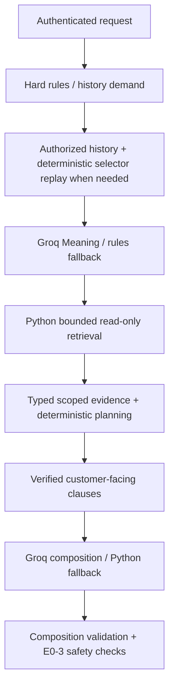

# Brandora AI: نفهم المشروع من الرسالة لحد الرد

تاريخ المراجعة: 2026-11-04. ده شرح للكود الموجود وقت المراجعة، مش إعلان إن النظام اتربط أو اتنشر.

## 0. إحنا راجعنا إيه؟

الـ workspace هو `C:\Users\ELTANANY 01062856027\Desktop\brandora-ai`، والـ branch هو `feature/backend-ai-integration`. الـ working tree فيه تعديلات وملفات untracked من الشغل السابق؛ المراجعة شملت الملفات دي، مش نسخة Git القديمة بس. في المهمة دي ما اتغيرش application code أو tests أو `.env`؛ اتضافت خمس ملفات الشرح المطلوبة بس.

قرأنا FastAPI factories، security boundary، history/retrieval/planning، providers، schemas، mocks، الاختبارات وإعدادات التشغيل. راجعنا GitHub Backend قراءة فقط:

| مصدر الدليل | النسخة اللي اتراجعت | معناها |
|---|---|---|
| Backend `main` | `83a65e9fc1f3f6994a7d115d6b83d86d3dd4d08b` | Products/Variants/Auth/Inventory موجودين |
| Conversations [PR #1](https://github.com/shrouqshaker/brandora-backend/pull/1) | `0e92d6b5d038aa6da87c76ee5f06d29aebe4127a`، OPEN، `merged_at=null` | شغل تحت المراجعة، مش في main |
| قائمة PRs كلها وقت الفحص | PR #1 فقط | ما ظهرش Orders PR؛ ده مش ادعاء عن شغل خاص خارج الريبو |
| Railway account / Production DB | ما اتفتحوش | deployment الفعلي وبيانات Neon: UNVERIFIED |

شغّلنا الاختبارات فعلًا في المراجعة: **1580 passed، 0 failed، 0 skipped، warning واحدة** مع `-p no:cacheprovider`. وشغّلنا HTTP evaluation: **12 سيناريو / 23 رسالة**، وrules/fake: **17 رسالة لكل واحد**؛ كلهم نجحوا. اختبار Backend نفسه أو live Groq أو Railway build ما اتشغلوش. النتائج السابقة في التقارير القديمة تعتبر historical evidence، مش إثبات تشغيل هنا.

## 1. خريطة بسيطة للمصطلحات

تخيل Python مساعد بيع بيقرأ بيانات المحل، وBackend هو المسؤول عن البيانات والصلاحيات:

| المصطلح | دوره هنا | المثال الحقيقي |
|---|---|---|
| FastAPI | يستقبل HTTP ويطبق request/response models؛ مش هو اللي بيفهم اللغة | `app/http.py:create_app` |
| Python AI application | فهم + تنسيق قراءات + تخطيط + رد آمن | `ChatSession.send` و`StandalonePipeline.execute` |
| Groq API | نموذج خارجي لفهم الرسالة وترتيب الرد | `app/providers/groq.py:GroqClient` |
| Tool name | اسم عملية مسموح بيها، مجرد قيمة في JSON | `get_variant_details` |
| Python function | كود ينفذ العملية بعد التحقق | `BackendClient.get_variant_details(product_id, variant_id, ...)` |
| HTTP endpoint | عنوان وطريقة طلب بين خدمتين | `POST /internal/ai/data`، **PROPOSED في Backend** |
| NestJS Controller | يستقبل route ويوصلها للـ Service | `ProductsController.get` |
| NestJS Service | business logic والتحقق والاستعلامات | `ProductsService.get` |
| Prisma query | طلب من الكود لقاعدة PostgreSQL | `tx.catalogItem.findFirst({where:{id,businessId}})` |
| Neon | استضافة PostgreSQL لو اختارها التشغيل | Python هنا ما بيتصلش بالـ DB مباشرة؛ حساب Neon مش متراجع |
| Railway | بيشغل service من المشروع | `railway.json` بيطلب `python -m app.server`؛ مش دليل deployment |

**Python Tool Orchestration** معناها Python يختار وينفذ عمليات allowlist محددة. **Native Model Function Calling** معناها النموذج يرجع tool calls أصلًا. المسار الحالي مش بيدي Groq حق ينفذ HTTP أو يختار businessId؛ بيرجع `Meaning` ويتراجع بـ Pydantic والتحقق الدلالي، وبعدها Python يقرر القراءات.



المسار ده مركب في `app/products_api.py:build_products_router`، و`app/conversation_api.py:execute_conversation`، مش diagram عام من غير تنفيذ.

## 2. Products & Variants من البداية

### 2.1 الفرق بين المنتج والاختيار

Product هو «تيشيرت قطن». Variant هو تركيبة موجودة فعلًا: «Black / L». `options` في Product بتشرح القيم الممكنة؛ وجود `Black` و`L` في القوائم مش كفاية نختلق تركيبة. لازم `ProductVariant.optionValues` يثبتها.

في الـ synthetic catalog: Black/M=250، Black/L=275، White/L=285، White/M=225 ومش tracked، Blue/M سعره **0.00 فعلًا** ومخزونه صفر، Blue/L inactive وسعره المسحوب 205، وCap سعره null. ده في [synthetic.py](../app/chat/synthetic.py)، `catalog` عند line 25. الصفر غير null: null معناه السعر مجهول؛ صفر سعر معروف، مش معنى إن السعر ناقص.

### 2.2 الرسالة بتتحول لقراءات إزاي؟

1. `ConversationInterpreter.understand` في [understanding.py](../app/chat/understanding.py) line 194 يجهز قواعد `rules_meaning`، وبعدها Groq لو متاح. `Meaning` فيه `act`, `search`, `product_handle`, `options`, `quantity`, `option_alternatives`؛ مفيهوش credential أو business authority.
2. `validate_selection` جوه نفس الدالة يرفض handle مخترع، ضياع اختيار صريح، search مخترع أو comparison ناقصة. provider غير صالح يرجع لقواعد آمنة.
3. `Inquiry` في [schemas/inquiry.py](../app/schemas/inquiry.py) بيشيل الاختيارات المنظمة لباقي المراحل. `app/data/search.py:canonical_search` و`app/data/retrieval.py:_matches` يعيدوا استخدام NLU والمطابقة مع qualifiers؛ مفيش fuzzy match مفتوح يسمح باختيار منتج مختلف.
4. [retrieval.py](../app/data/retrieval.py) فيه `RetrievalCoordinator` و`_Execution` لكل طلب. greeting ملهوش أدوات؛ اسم جديد يبدأ catalog search؛ reference موثوق يقدر يقرأ details مباشرة؛ options تتطابق مع variants فعلية قبل lookup محدد. لو فيه أكتر من منتج، يسأل بدل اختيار عشوائي.
5. البحث محدود: defaults `RetrievalLimits` هي 8 calls، 3 product pages، 100 records، 4 detail lookups، 5 ثواني، page size 10. الحدود ممكن توقف قبل نهاية الكتالوج؛ ساعتها partial، مش «المنتج مش موجود في المحل كله».
6. [data/backend.py](../app/data/backend.py): `BackendDataAccess` يحول full envelopes إلى typed evidence، ويتأكد من tenant وparent IDs. حالات failure زي INVALID وSCOPE_MISMATCH مختلفة؛ مش بيحول error لقائمة فاضية ناجحة.
7. [evidence_planner.py](../app/pipeline/evidence_planner.py): `EvidencePlanner.plan` line 209 يجمع `ProductFact` و`VariantFact` وsources. [application.py](../app/chat/application.py): `ConversationPlanner.plan` line 115 يضيف focus/quantity/review policy؛ مش نموذج لغوي بيحسب السعر.
8. [natural.py](../app/chat/natural.py): `clauses_for` line 78 يجهز جمل من حقائق immutable. `NaturalResponder.generate` يطلب من Groq **ترتيب fact IDs** في `NaturalReply`، مش كتابة أسعار أو وعود من عنده. `validate_composition` line 184 يلزم كل ID مرة وبالترتيب؛ الأسئلة الإجبارية Python بيرندرها.
9. `compile_manifest`/`validate_plan` في [evidence_guard.py](../app/pipeline/evidence_guard.py) line 73/118 يراجعوا أصل الحقائق والعلاقات؛ `StandalonePipeline.execute` يمنع response يغير intent/review أو يطلع orderCandidate. Guard الحالي طبقات تحقق، مش مجرد فلتر كلمات على رد حر.

### 2.3 الأدوات الأربع

التنفيذ في [backend_client.py](../app/clients/backend_client.py): `_TOOLS`، `validate_arguments`، `call_tool` والـ convenience methods. Python parameters snake_case، وwire keys camelCase:

| Tool | Python parameters | `arguments` على الشبكة | الهدف |
|---|---|---|---|
| `get_products` | `limit, offset` | `limit, offset` | صفحة منتجات للمطابقة المحلية، مش search API من اختراعنا |
| `get_product_details` | `product_id` | `productId` | المنتج وembedded variant page |
| `get_product_variants` | `product_id, limit, offset` | `productId, limit, offset` | استكمال actual variants لو embedded page مش كفاية |
| `get_variant_details` | `product_id, variant_id` | `productId, variantId` | قراءة حالية لاختيار بعينه مع parent صحيح |

الـ client foundation عنده كمان `get_conversation_history` و`get_business_info`. canonical HTTP يسمح بالأربع + history بس؛ Products compatibility بالأربع بس. business info مش متاح كقدرة مفتوحة في canonical. راجع `PRODUCT_TOOLS`/`CONVERSATION_TOOLS`، مش عدد methods بس.

مقتطف فعلي من `BackendClient.call_tool`:

```python
headers = {
    "Authorization": f"Bearer {self._service_token}",
    "X-AI-Context": context_token,
}
# client.post(...)
json={"tool": tool, "arguments": args}
```

كل call له headers وAsyncClient خاصين، timeout، `follow_redirects=False`، `trust_env=False`؛ مفيش retry تلقائي للـ Backend، ولا customer token متخزن كحالة shared. errors sanitized. UUID canonical من غير اشتراط v4 لكل identifiers. `limit` 1..100، offset آمن لـ JavaScript، bool/float مرفوضين.

### 2.4 الموجود فعلًا في Backend main

المراجع دي pinned على commit اللي اتراجع؛ مش فرع PR:

* [ProductsController](https://github.com/shrouqshaker/brandora-backend/blob/83a65e9fc1f3f6994a7d115d6b83d86d3dd4d08b/src/products/products.controller.ts): `GET /businesses/:businessId/products` و`GET .../:productId`، ومعاهم create/update/soft-delete للمالك. `@AuthScope('params')` موجود.
* [ProductsService](https://github.com/shrouqshaker/brandora-backend/blob/83a65e9fc1f3f6994a7d115d6b83d86d3dd4d08b/src/products/products.service.ts#L84): `list` pagination في RepeatableRead transaction؛ `get` line 114 يستدعي `read` line 199 ويرجع **product مباشرة**.
* [VariantsController](https://github.com/shrouqshaker/brandora-backend/blob/83a65e9fc1f3f6994a7d115d6b83d86d3dd4d08b/src/variants/variants.controller.ts): `GET /businesses/:businessId/products/:productId/variants` و`GET .../:variantId`.
* [VariantsService](https://github.com/shrouqshaker/brandora-backend/blob/83a65e9fc1f3f6994a7d115d6b83d86d3dd4d08b/src/variants/variants.service.ts): `list/get/scoped` يتحققوا من business+product+variant؛ Prisma هو اللي يكلم DB.
* [ProductAccessService](https://github.com/shrouqshaker/brandora-backend/blob/83a65e9fc1f3f6994a7d115d6b83d86d3dd4d08b/src/products/product-access.service.ts): وجود business/product/category وscoped locks. ده مش بديل عن auth guard.
* [AuthGuard](https://github.com/shrouqshaker/brandora-backend/blob/83a65e9fc1f3f6994a7d115d6b83d86d3dd4d08b/src/auth/auth.guard.ts)، و[AuthModule](https://github.com/shrouqshaker/brandora-backend/blob/83a65e9fc1f3f6994a7d115d6b83d86d3dd4d08b/src/auth/auth.module.ts): global user JWT/session/membership guard. ده OWNER authentication حالي، **مش S2S AI service authentication**.

مقتطف فعلي من `ProductsService.read`:

```typescript
const product = await tx.catalogItem.findFirst({
  where: { id, businessId },
  include: productInclude,
});
```

`where` بيقيد المنتج بالمحل. الأمان الكامل محتاج كمان مين صاحب الطلب، وحقه في business دي؛ الـ public routes عندها guard ده. dispatcher الداخلي لازم يعمل service authorization منفصل بدل استخدام OWNER token في Python.

### 2.5 سعر ومخزون: أهم التفاصيل

في [product-presenter.ts](https://github.com/shrouqshaker/brandora-backend/blob/83a65e9fc1f3f6994a7d115d6b83d86d3dd4d08b/src/products/product-presenter.ts#L13): `effectivePrice = unitPrice ?? basePrice` ويتحول string بـ `toFixed(2)`. Product فيه أول 20 variants ومعاهم `variantsPagination`. `isSellable = product.isActive && pricedActiveVariant`، يعني فيه variant نشط بسعر، **مش ضمان stock**.

في [schema.prisma](https://github.com/shrouqshaker/brandora-backend/blob/83a65e9fc1f3f6994a7d115d6b83d86d3dd4d08b/prisma/schema.prisma#L135) Product اسمه DB `CatalogItem`، و`ProductVariant` line 177. السعر `Decimal(12,2)`؛ Python [schemas/backend.py](../app/schemas/backend.py) line 35 يقبل string بحد أقصى 10 integer digits و2 fractional، ويحتفظ بـ Decimal. ما بنحوّلش float ولا نعوض null بسعر مخترع. فرق 285−275=10 بيتحسب في [price_comparison.py](../app/pipeline/price_comparison.py): `compare_verified_pair`.

`trackInventory=true` لازم integer stock ≥0؛ false لازم null. التناقض INVALID. stock خاص بالـ variant، مش Product parent. Product lists مش snapshot ثابت عبر كل الصفحات؛ pagination totals ممكن تتغير بسبب writes. History لها شرط snapshot أقوى؛ ما نخلطش القاعدتين.

### 2.6 إيه اللي ناقص قبل الربط؟

`POST /internal/ai/data` **مش موجود في main ولا PR #1 اللي اتراجع**. مطلوب dispatcher آمن يعيد استخدام services الموجودة، يثبت الصلاحيات من service token وsigned context، ويغلف الرد `{tool,data}`. مفيش داعي إعادة بناء Products CRUD. details: `data` هو product/variant مباشرة، مش `data.product`. `get_business_info` aggregate محدود مقترح منفصل، مش knowledge API للسياسات.

اختبارات Products هنا MOCK-TESTED، بما فيها pagination، malformed DTOs، auth failures، inactive، Decimal والـ variants. مش إثبات إن Backend real dispatcher بيرجع الـ DTO. [Testing handbook](BRANDORA_AI_TESTING_HANDBOOK.md) فيه خطوات كل حالة.

**Products readiness:** [ ] internal dispatcher موجود؛ [ ] S2S وسياق signed؛ [ ] إعادة استخدام scoped services؛ [ ] DTO contract مطابق؛ [ ] negative tenant tests على Backend؛ [ ] staging reads حقيقية؛ [ ] مراجعة عرض السعر/المخزون. AI offline جاهز؛ integration لسه BLOCKED.

## 3. Conversations & History

### 3.1 بنفتكر إزاي من غير global session؟

كل canonical HTTP request فيه خمس حقول بس. Backend المفروض يحفظ الرسالة ويرسل IDs المعتمدة. Python لا يحتفظ بـ live customer session بين HTTP requests. [conversation_api.py](../app/conversation_api.py): `execute_conversation` line 131 ينشئ `RequestProductData` وreplay `ChatSession` جديدين، وبعده session للدور الحالي. `Selection` في understanding.py line 39 فيه product hints/options/quantity/alternatives؛ مش بيانات persistent للعميل.

`needs_conversation_history` line 166 يسأل: هل الرسالة محتاجة مرجع قديم؟ size/quantity/لون بس عادة نعم. اسم منتج جديد واضح أو greeting أو cancellation عادة لا. مش Groq اللي بيختار إنه يقرأ تاريخ عميل تاني.

`HistoryService.prepare_authorized` في [history.py](../app/data/history.py) line 222:

1. يطلب `get_conversation_history(conversationId,limit,offset)` بسياق الطلب الموثوق.
2. `BackendDataAccess.get_conversation_history` line 122 يفرض page metadata للـ business/customer/conversation/current message، وكل row لنفس conversation.
3. pagination default 20، max 3 pages / 60 rows / 12000 characters / 5 seconds. request كله له cache/budget 12 actual Backend reads، والـ canonical deadline default 25 ثانية.
4. لازم `snapshot` ثابت و`totalCount` ثابت عبر صفحات نفس history، و`order=createdAt_desc_id_desc`، و`complete=true`، و`beforeMessageCreatedAt` صحيح. كل الرسائل قبل الحد strictly؛ current/later message مرفوض. same-time CUSTOMER rows مش ترتيب مؤكد؛ يتعامل معاها كـ partial. identical duplicates تتعمل dedup، conflicting duplicates تفسد الاكتمال.
5. لو partial/unavailable مفيش replay جزئي يخمن منتج؛ يسأل clarification. auth/scope rejection يرجع 403 ويمنع استخدام البيانات.
6. التاريخ بيتحول chronological للـ replay. بس `CUSTOMER` يتعاد فهمه deterministic؛ `AI` و`OWNER` مش selectors ولا facts. محادثة قديمة بتقول «السعر جنيه» مش مصدر سعر جديد.

**حد العقد مهم:** `before_message_id` parameter في Python للتحقق من الرد، لكنه **مش ضمن wire arguments** في BackendClient. Backend لازم يستنتج الحد من signed `messageId` ويعيد `beforeMessageId` المطابق. كمان snapshot مش بيتبعت من Python كـ cursor جديد في كل صفحة؛ Backend لازم يضمن نفس الـ snapshot عبر نفس سياق الطلب. تفاصيل التنفيذ/الاحتفاظ بالـ snapshot لازم تتفق وتتختبر، مش موجودة دلوقتي.

### 3.2 الأربع رسائل خطوة بخطوة

| الدور | اللي بيحصل فعلًا | Tools في التشغيل synthetic اللي اتعاد هنا |
|---|---|---|
| `عندكم تيشيرت أسود؟` | auth+IDs؛ اسم منتج صريح، مفيش history؛ Groq/rules يفهموا Black؛ actual Black/M وBlack/L؛ يوضح 250/275 ويسأل المقاس | `get_products`, `get_product_details` |
| `طب مقاس L بكام؟` | history مطلوب؛ restore تيشيرت+Black من CUSTOMER؛ fresh product evidence؛ Meaning يحتفظ بمرجع المنتج ويغير size؛ السعر الحالي275 | `get_conversation_history`, `get_products`, `get_product_details`, `get_variant_details` |
| `طب عايزة 10 قطع من مقاس L` | history يعيد Black/L؛ quantity10؛ fresh tracked stock4 داخليًا؛ shortage؛ review offer؛ مفيش order | نفس أدوات الدور التاني |
| `طب خلاص، خليهم 3 قطع من الأبيض مقاس L بدل الأسود` | history مطلوب؛ `selection_text` يشيل Black كقيمة مستبدلة؛ يبقى White/L وquantity3؛ current price285، stock8 داخليًا؛ review=false | history, products, product_details, variant_details **مرتين** |

الـ variant_details الإضافي في الدور الرابع سببه replay لاختيار Black/L ثم fresh White/L، مش إنشاء order. cache داخل request يختصر القراءات المتكررة؛ history نفسها مش مصدر السعر. بعض selector replay بيحتاج Product reads لاستعادة الاسم والـ options؛ مش كل القراءات بتحصل بعد Groq الحالي فقط.

سبب regression القديم كان `خلاص` بتمنع history demand باعتبارها search term، وكمان old/new colors بيتجمعوا. ده متصلح ومتختبر في [test_customer_stock_regression.py](../tests/test_customer_stock_regression.py)، مش فرضية جديدة.

### 3.3 Backend main مقابل PR

main الحالي مفيهوش Customer/Conversation/Message models أو module دي. PR #1 يضيفهم في [schema.prisma على PR head](https://github.com/shrouqshaker/brandora-backend/blob/0e92d6b5d038aa6da87c76ee5f06d29aebe4127a/prisma/schema.prisma)، ويضيف:

* [ConversationsController](https://github.com/shrouqshaker/brandora-backend/blob/0e92d6b5d038aa6da87c76ee5f06d29aebe4127a/src/conversations/conversations.controller.ts): list/get/messages تحت `/businesses/:businessId/conversations`.
* [ConversationsService](https://github.com/shrouqshaker/brandora-backend/blob/0e92d6b5d038aa6da87c76ee5f06d29aebe4127a/src/conversations/conversations.service.ts#L70): `ingestInboundMessage` يعمل upsert Customer/Conversation ويحفظ CUSTOMER Message؛ externalMessageId unique والتكرار scoped-business يتراجع؛ `getOne` line176 يقيد business؛ `listMessages` line187 count+findMany newest-first.
* [DevInboundController](https://github.com/shrouqshaker/brandora-backend/blob/0e92d6b5d038aa6da87c76ee5f06d29aebe4127a/src/conversations/dev-inbound.controller.ts): `POST /businesses/:businessId/dev/inbound-message`، flag مقفول افتراضيًا. ده **محاكاة inbound**، مش WhatsApp webhook.

PR head ده مفيهوش auth infrastructure الحالية في main؛ Controllers نفسها مفيهاش auth guard. businessId filter موجود، لكن مش authentication ولا إثبات إن caller مالك المحل/العميل. دمجه في main محتاج merge/rebase ومراجعة auth policy؛ global main AuthGuard بيرفض operation بلا scope policy. ما ينفعش نفترض إن routes بعد الدمج هتكون جاهزة تلقائيًا.

PR history response مفيهوش canonical `customerId/businessId/beforeMessageId/snapshot/complete` attestation، ولا snapshot ثابت عبر pages، ولا current-message cutoff. مينفعش ناخده مباشرة ونقول ده نفس العقد. AI-side history tool موجود؛ secure Backend endpoint لسه PROPOSED.

**Conversations readiness:** [ ] مراجعة ودمج PR بأمان؛ [ ] caller authorization + customer ownership؛ [ ] canonical DTO/snapshot/cutoff؛ [ ] تخزين الرسالة قبل AI؛ [ ] handling duplicate/reordered messages؛ [ ] حفظ AI reply وreview state؛ [ ] cross-customer staging tests. من غيرهم context الحقيقي BLOCKED، حتى لو offline ممتاز.

## 4. Orders & Purchase Intent

`PURCHASE_INTENT` معناها «العميل عايز يشتري»، مش order اتعمل. `Meaning.quantity` وreferences ممكن يبقوا مبدئيين؛ مفيش موافقة مالية ولا خصم stock. E0-3 في [schemas/response.py](../app/schemas/response.py) فيه تاريخيًا `CONFIRMED_ORDER` وOrderCandidate models للتوافق، لكن المسار الحالي يمنعهم.

`StandalonePipeline.execute` في [standalone.py](../app/pipeline/standalone.py) يراجع إن `orderCandidate is None` وintent مش CONFIRMED_ORDER، والـ HTTP boundary يعيد نفس التحقق. [extensions.py](../app/pipeline/extensions.py): `DisabledOrderExtension.enabled=False` من غير enable switch أو execution handler؛ `ProvisionalPurchaseIntent` مجرد metadata، ويعيد references بـ `revalidated=False` لأي استخدام مستقبلي. مفيش Orders HTTP tool، inventory mutation، reservation أو cancel-real-order في المسار ده.

### 4.1 هل فيه legacy orders؟

أيوه: [planner.py](../app/pipeline/planner.py)، [orchestrator.py](../app/pipeline/orchestrator.py)، v1 request/response models وtemplates فيهم order-candidate وconfirmation/cancellation logic. ده مش Backend order persistence. `main.py` يخلق compatibility app؛ `/v1/ai/respond` ممكن يظهر لو `legacy_api_enabled=true`. release `app/server.py:create_application` line 9 يفرض `legacy_api_enabled=False` و`ai_provider=rules` للـ legacy provider container؛ فلا legacy pipeline ولا Gemini الافتراضي يدخلوا canonical Groq path. وجود legacy tests مش معناه إن Railway launcher بيشغله.

### 4.2 shortage وrequiresReview بالضبط

في `ConversationPlanner.plan` line115: PURCHASE_INTENT + SINGLE_VARIANT + منتج/اختيار واحد active، options verified، كمية معلومة أكبر من tracked stock، بدون failure/ambiguity/partial limitations: `requiresReview=true`, internal `ReviewReason.OUT_OF_STOCK_RISK`. ordinary freshness/non-reservation limitations مسموحة. ده متوافق مع معنى owner attention السابق في legacy `_apply_owner_flags`، مش إعادة تعريفه كإيصال إرسال.

مثال الرد اللي اتعاد فعلًا:

> تمام، بالنسبة للـ10 قطع من الأسود مقاس L بـ275 جنيه للقطعة، والكمية دي مش متاحة بالكامل حاليًا. نراجع إمكانية توفير الكمية مع المسؤول؟

الـ 4 موجودة internally للتحقق ومش معروضة. `requiresReview=true` إشارة triage للـ Backend؛ السؤال عرض للمساعدة، مش إثبات consent ولا notification تمت. ما اتنفذش notify/ticket/order. لما العميل يغير لـ3 White/L، stock8 الحالي يكفي الملاحظة لكن مفيش ضمان reservation: review=false، price285 والتوافر النهائي يحتاج تأكيد.

Exact stock disclosure محتاج **العميل يسأل عدد صراحة** + business UUID معتمد في `STOCK_QUANTITY_DISCLOSURE_BUSINESSES`؛ default empty. `asks_stock_quantity` من كلام العميل، مش model focus. policy دي تشغيلية، مش flag العميل يبعتها. Unknown/invalid/untracked مش أرقام نخمنها؛ صفر confirmed يتوصف unavailable، مش restock promise.

### 4.3 Orders في Backend فعلًا

main [Prisma schema](https://github.com/shrouqshaker/brandora-backend/blob/83a65e9fc1f3f6994a7d115d6b83d86d3dd4d08b/prisma/schema.prisma) مفيهوش Order/OrderLine models، وtree/AppModule مفيهمش Orders controller/service. PR #1 برضه مش Orders implementation.

لكن [InventoryService](https://github.com/shrouqshaker/brandora-backend/blob/83a65e9fc1f3f6994a7d115d6b83d86d3dd4d08b/src/inventory/inventory.service.ts#L323) فيه `deductForOrder` و`restoreForOrder`، بياخدوا transaction وstable orderLineId، ومعاهم `ORDER_APPROVED/ORDER_CANCELLED` movement types. دي primitives للمخزون عشان future caller، **مش دليل Order table/API/state machine**. حافظوا عليها عند التصميم بدل إعادة اختراع stock deduction.

### 4.4 FUTURE DESIGN — مش تنفيذ حالي

Purchase intent → validate product/variant/quantity من DB حديثة → موافقة العميل/المالك حسب السياسة → Backend ينشئ order داخل transaction مناسبة → stock handling → حفظ state → notifications/delivery من Backend. retry بنفس idempotency key ما يعملش duplicate order أو deduction.

قرارات صاحب المنتج المطلوبة: مين يوافق؟ إمتى يتخصم stock؟ هل reservation موجود وبيexpire؟ untracked/shortage يتعامل إزاي؟ changes/cancellation بعد الموافقة؟ price freshness/قبول تغير السعر؟ مين يشوف review تلقائيًا ومتى consent مطلوبة؟ retry/WhatsApp delivery وسياسة إظهار stock؟ مفيش قرار منهم النموذج ياخده نيابة عنكم.

**Orders readiness:** intentionally NOT IMPLEMENTED/DISABLED. [ ] approved contract/state machine؛ [ ] Order models/service/auth؛ [ ] fresh transactional validation؛ [ ] idempotency؛ [ ] approvals/notifications؛ [ ] real negative/retry tests؛ [ ] بعد كده فقط AI extension تتراجع. دلوقتي الاختبارات تثبت **عدم إنشاء order**، مش جاهزية إنشاء orders.

## 5. FastAPI والاتصال والأمان

### 5.1 routes الحقيقية

المصدر [http.py:create_app](../app/http.py) line25، و[products_api.py:build_products_router](../app/products_api.py) line79:

| Route | إمتى موجودة؟ | وظيفتها |
|---|---|---|
| `POST /v2/ai/respond` | `AI_INTEGRATION_ENABLED=true` | canonical خمس حقول، history on demand |
| `POST /v2/ai/products/respond` | `PRODUCTS_INTEGRATION_ENABLED=true` | compatibility ProductRequest: businessId/messageId/message، بلا history |
| `POST /v2/ai/respond-with-context` | canonical enabled + `SUPPLIED_CONTEXT_COMPAT_ENABLED=true` | deprecated supplied history profile، مقفول افتراضيًا |
| `GET /health/live` | دايمًا | process يرد، مش اختبار Backend |
| `GET /ready` | دايمًا | 200 لو canonical enabled، وإلا503؛ `backendLiveVerified:false`, `ordersEnabled:false` |
| `GET /`, `GET /health` | دايمًا | وصف/legacy provider health؛ متستخدمش `?probe=true` في فحص offline لو live legacy provider configured |
| `POST /v1/ai/respond` | `legacy_api_enabled` فقط | القديم، request مختلف |
| `/v1/dev/*` | `ENABLE_DEV_ENDPOINTS` فقط | playground قديم، release بيرفض تشغيله |

FastAPI `/docs` و`/openapi.json` الافتراضيين موجودين؛ route listing مش كله AI tools. `/ready` config signal مش provider/DB probe. `main.py` wrapper، وrelease entry مختلفة زي ما فوق.

### 5.2 مين بيصدر ويتحقق من التوكن؟

Backend **لازم يصدر مستقبلًا** context JWT بـ private RSA key بعد التحقق من ownership. AI عنده public key بس، بيتحقق في `authenticate` line110. التوقيع RS256، RSA ≥2048 bits. `kid` المسموح في header مش dynamic key discovery؛ validator الحالي مبني على configured public key واحد، فkey rotation محتاج خطة.

| اتجاه | Header | مين يتحقق؟ |
|---|---|---|
| Backend → AI | `X-Internal-Token` = AI_SERVICE_TOKEN | AI constant-time compare |
| Backend → AI | `X-AI-Context` signed JWT | AI signature/claims/body hash/IDs |
| AI → Backend tools | `Authorization: Bearer <BACKEND_SERVICE_TOKEN>` | Backend S2S verifier المطلوب |
| AI → Backend tools | نفس `X-AI-Context` للطلب | Backend يتحقق مستقلًا من scope/ownership/current boundary |

الخدمتين عندهم secrets اتجاهية مختلفة ≥32 printable ASCII وبدون whitespace؛ ما نستخدمش نفس السر للاتجاهين. JWT مش مجرد base64 نثق فيها. canonical claims: `iss=brandora-backend`, `aud=brandora-ai-tools-v1`, `scope=products:read conversations:read`, IDs الأربعة، `requestHash` SHA256 للـ **raw HTTP body bytes**، وiat/exp StrictInt؛ مدة ≤300 ثانية، no clock skew، وnbf لو موجود لازم مش في المستقبل. raw JSON إعادة ترتيبه بعد التوقيع يكسر hash.

Products compatibility تستخدم `aud=brandora-ai-products`, `scope=products:read` ومفيهاش requestHash/customer/conversation. supplied-context تستخدم aud=brandora-ai وscope=products:read مع body hash. ما تخلطش التلات profiles؛ canonical هو المستهدف الجديد.

`IntegrationIngress` في [ingress.py](../app/ingress.py) line20 يحد v2 body بـ65536 bytes و10ثواني قراءة؛ staging/production تتطلب HTTPS. خلف proxy نصدق `X-Forwarded-Proto:https` واحد بس لو socket peer داخل `TRUSTED_PROXY_CIDRS` المعتمدة. wildcard وforwarded chains مش بديل لمعرفة proxy الحقيقي. Uvicorn release عنده `proxy_headers=False`.

### 5.3 رحلة الاتصال الكاملة: الواقع والمقترح

| السهم | initiator / receiver | العقد | الحالة |
|---|---|---|---|
| Customer → WhatsApp | العميل → منصة WhatsApp | platform message، مش AI JSON | خارج Python؛ integration الخاص بالمشروع غير منفذ في المصادر المتراجعة |
| WhatsApp → Backend | platform → webhook مستقبلي | signature verification + normalize/ownership + external ID | لا route منفذ للـ real webhook في main/PR المتراجع؛ ما اخترعناش اسمه |
| Backend persistence | Backend → Prisma | Customer/Conversation/Message write | ingest أساسه في PR فقط؛ real webhook مش موجود |
| Backend → FastAPI | Backend → `POST /v2/ai/respond` | headers والـ JSON تحت | AI endpoint IMPLEMENTED، Backend caller/signing PROPOSED |
| AI → Backend reads | BackendClient → `POST /internal/ai/data` | Bearer + context؛ `{tool,arguments}` | AI client IMPLEMENTED، Backend receiver PROPOSED |
| Backend → PostgreSQL | services → Prisma | scoped `where` queries | Products/Variants موجودين في main، canonical history مش موجود |
| Backend data → AI | HTTP response | `{tool,data}`؛ validated typed evidence | mock-tested، مش live-tested |
| AI → Groq → AI | GroqClient → fixed chat completions endpoint | Bearer provider key، `messages`, `response_format` | adapter IMPLEMENTED؛ لا live call اتعملت في المراجعة |
| AI → Backend | FastAPI response | exact E0-3 الأربع keys | IMPLEMENTED/MOCK-TESTED |
| Backend → persistence → WhatsApp | orchestrator/outbox مستقبلي | dedup، reply/review state، delivery result | current full flow NOT IMPLEMENTED في المصادر المتراجعة |

Canonical body **بدون history أو model/tool/business overrides**:

```json
{
  "businessId": "00000001-0000-4000-8000-000000000001",
  "customerId": "00000002-0000-4000-8000-000000000001",
  "conversationId": "00000003-0000-4000-8000-000000000011",
  "messageId": "00000009-0000-4000-8000-000000000001",
  "message": "طب مقاس L بكام؟"
}
```

كل IDs دي أمثلة synthetic، مش production. الرد:

```json
{"intent":"INQUIRY","reply":"تمام، الأسود مقاس L بـ275 جنيه","requiresReview":false,"orderCandidate":null}
```

الـ response headers فيها `X-AI-History-Status`, `X-AI-Contract`, provider names وmessage ID؛ دي diagnostics، مش حقول زيادة في E0-3. العقود الكاملة للأدوات والـ history في [Backend checklist](BRANDORA_BACKEND_IMPLEMENTATION_CHECKLIST.md).

### 5.4 دور Groq الحالي وحدوده

`build_products_router` يبني ProviderChain بـ **Groq فقط** لو المفتاح configured، وإلا rules fallback. وجود OpenRouter/Gemini adapters و`CHAT_PROVIDER_ORDER` في الكود مش معناه إن canonical release بيعمل auto-failover ليهم؛ دي قدرات historical CLI. نموذج Groq المعرّف حاليًا `openai/gpt-oss-120b`؛ دي قراءة config، مش verification لتوفره live اليوم.

`GroqClient.groq_schema` يستخدم strict structured output لما كل objects مقفولة، وbest-effort schema لـ Meaning dynamic option maps، مع strict application parsing/semantic validation في الحالتين. `ProviderChain` فيه bounded deadlines وcircuit/recovery health state؛ الحالة shared دي provider health بس، مش customer history/token. NaturalReply presentation مقيد؛ طبيعيته محدودة بالـ verified clauses، مش رد حر كامل. failures ترجع نفس القواعد والـ Grounding safeguards.

## 6. إيه الجاهز وإيه لأ؟

AI read-only conversation path، auth verification، typed evidence، context restore، safe stock policy والـ fallback **IMPLEMENTED/MOCK-TESTED**. Backend Products الأساسية IMPLEMENTED. canonical internal dispatcher/token issuance/history guarantees وreply delivery **PROPOSED/NOT IMPLEMENTED**. Orders مقفولة عمدًا. Railway launch config prepared وmock-tested؛ deployment وجوده **UNVERIFIED**، build في Railway مش متعمل في المراجعة.

ملاحظات audit من غير إصلاح كود: cancellation `خلاص مش عايزة` عملت `get_products` إضافية في demo رغم إن الرد safe؛ greeting-style availability caveat بتتكرر لكل variant في أول رد؛ wording ممكن تتحسن لاحقًا. كمان في docstrings قديمة بتقول standalone/no-live-wiring أو إن response «never sends prices»؛ المقصود structured order fields، لكن `reply` الحالي بيعرض verified prices فعلًا. الكود والاختبارات الحالية أصدق من الوصف القديم.

للتجربة: [Testing handbook](BRANDORA_AI_TESTING_HANDBOOK.md). للتسليم: [Backend checklist](BRANDORA_BACKEND_IMPLEMENTATION_CHECKLIST.md). للنشر الآمن: [Railway readiness](BRANDORA_RAILWAY_READINESS.md). للحالة المختصرة: [Readiness matrix](BRANDORA_AI_READINESS_MATRIX.md).
